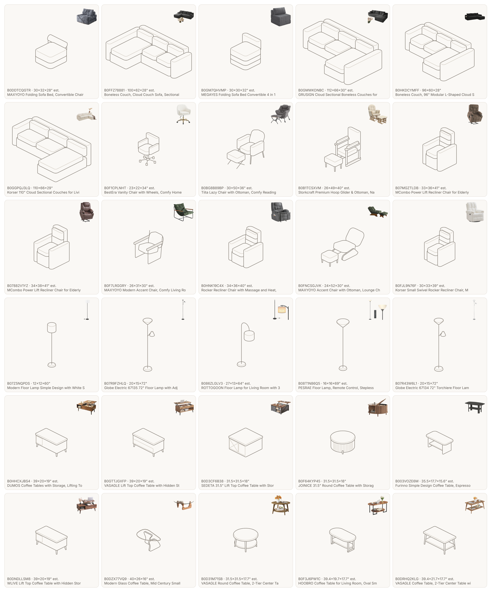
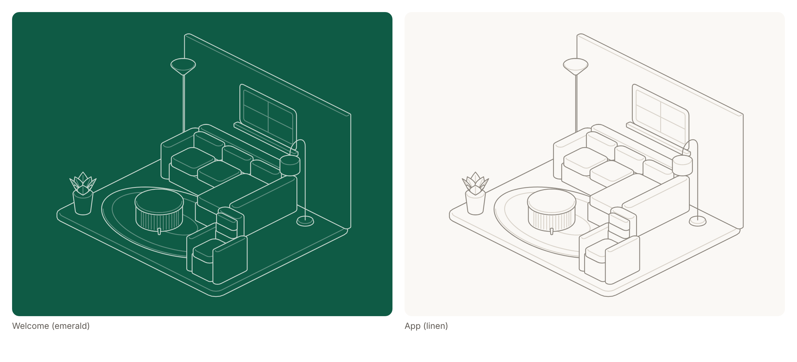
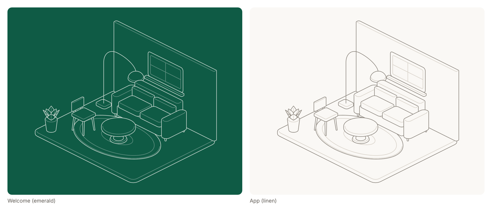

# Hairline furniture assets: style spec

Every furniture item in ENVEE is a line drawing in the Hairline style. All of them are drawn from **one camera, at one scale**, so any two items line up when they're placed in a room. The welcome screen's room (`hairline/layers.js`) is the reference.

Source: `hairline/items/` (`kit.js` builders, `pilot.js`, `amazon.js`) · Build: `npm run build:items` · Review sheet: `npm run sheet:items` → `docs/hairline-items.png` · Rooms: `npm run preview:items -- pilot|amazon` → `docs/hairline-pilot.png`, `docs/hairline-room-amazon.png`

Drawn so far: the 5 pilot pieces (style references) and the 30 cached Amazon Best Sellers that have a sticker. Each Amazon item is a kit builder (sofa, floorChair, recliner, glider, lounge, sling, rockerLounger, swivelChair, stickLamp, torchiere, hookLamp, caseTable, drumTable, twoTier, panelTable, glassTable) plus numbers read off its photo. Lift tops are drawn closed and recliners upright; props in the photos are left out.

## 1. Projection (locked)

| | |
|---|---|
| Camera | `Cam(45, 0.5, S)`: the welcome room's camera, unchanged |
| Type | Orthographic 2:1 dimetric. No perspective, so an item looks the same wherever it sits in the room |
| Azimuth | 45°. The item's **front faces lower-left**, and its **+x (right) end faces lower-right** |
| Elevation | 30° above the floor (`k = sin 30° = 0.5`). Floor lines run at about 26.6° (2 across : 1 down) |
| Vertical | 1 inch of height = `S × 0.866` px |

The welcome room already used this camera, so it didn't need changing. The in-app room backgrounds (`hairline/art/scenes.js`: the four rooms, the sample spaces and the looks) used a near-frontal `Cam(8, 0.6)` to suit the old photo cut-outs; they are now drawn at `Cam(45, 0.5)` too, as a corner (a back wall along x, a left wall along y), so placed items stand on their floors.

**The other side.** The other 3/4 view is the same SVG mirrored with `scaleX(-1)` about the anchor. It's never drawn twice. At a 45° azimuth, a mirror swaps the world's x and y axes. So a mirrored item **faces +x**: its front points lower-right and its width runs along y. In practice the flip button turns a piece 90° to face the other wall.

## 2. World and scale

- **1 world unit = 1 inch.** Each item is drawn at its real size from `dims` (W × D × H).
- Item axes: `x` runs across the width (0 → W), `y` from the back (0) to the front (D), and `z` up from the floor (0).
- **Scale: 2 viewBox px per inch** (`S = 2`, `ITEM_PX_PER_INCH`). Every item uses it, which keeps an 84" sofa and a 16" side table in true proportion.
- In a room, scale every item by `roomPxPerInch / 2`. The room's `S` is its px per inch.

## 3. Line and fill

| | |
|---|---|
| Stroke width | **1.1 viewBox units** on every line. Weight never changes: hierarchy comes from colour |
| Joins / caps | round / round |
| Silhouette (`sil`) | `#8C867E`, warm stone: the outline of each solid |
| Default line (`mid`) | `#B9B2A8` |
| Crease / detail (`lo`) | `#D9D3CA`: the one inner top edge, seams, rug borders |
| Fill (plate) | `#FAF8F5` (`C.canvas`). Every solid is opaque, so nearer parts hide farther ones (rule 06) |
| Background | transparent |
| Highlight (`hi`) | not used in assets. The editor marks the selected item itself, so a room never has two bright marks (rule 04) |

These are the app's **linen** colours: neutral next to the UI and on photos. For the emerald welcome, swap them one for one: `#FAF8F5→#0F5B45`, `#8C867E→#C6D6CE`, `#B9B2A8→#90B1A6`, `#D9D3CA→#5F9081`. No other colour appears in an asset.

## 4. Corners and construction

- Every solid is a rounded box or a turned drum (`rings` + `prism`, or `drum`), drawn as **a silhouette plus at most one crease**. Vertical corners are never drawn (rule 09).
- Every corner is rounded. Corner radius is at least 0.6" on legs and posts, 2–5" on upholstery, and 3"+ on slabs.
- Crease inset: 0.3–1.6", under half the part's shorter side.
- Parts are appended back to front: ascending `x + y`, then upward (rule 06).
- Thin linear parts (lamp poles, arcs) are a single `sil` stroke with no fill.

## 5. Level of detail

- **3–12 solids per item.** Legs, arms, base, back, cushions: the parts you'd name.
- Details only where the real object has them, drawn as `lo` lines: a rug's border, a medallion, drawer fronts.
- No textures, hatching, shading, shadows, text or logos. Colour and material belong to the product photo.
- Reference: study the product photo for proportions and part breakdown (leg style, arm shape, cushion count). Then build it from the real `dims`, not by tracing the photo's angle.

## 6. Asset format and manifest

Each item gets:

- `assets/items/<id>.svg`: a transparent SVG whose viewBox is tightly cropped (2 units of padding), with colours baked into attributes (no CSS) so `expo-image` renders it on iOS, Android and web.
- A manifest entry in `src/data/itemManifest.ts` (and `assets/items/manifest.json` for tooling):

| field | meaning |
|---|---|
| `id`, `productId`, `name` | the item and the catalog product it depicts |
| `svg`, `file` | the asset (`require`) and its repo path |
| `view` | the SVG's size, in viewBox units |
| `dims` | real W × D × H, in inches (bounding box) |
| `anchor` | **floor anchor**: the centre of where the item touches the floor, in viewBox units from the SVG's top-left |
| `footprint` | `shape` (`rect`/`ellipse`), `w` × `d` in inches, and its `outline` projected in viewBox units |
| `dimsFrom` | `name` when the product title states the size, `estimate` when it's a typical size for the kind (to replace with real dimensions), `spec` for the pilot |
| `sourceImage`, `productUrl` | the Amazon photo and page, from the cache, for "see real photo" (`null` for the pilot) |

The footprint can be smaller than `dims`. An arc lamp's footprint is just its base, and a pedestal table's is just its foot, so the anchor sits where the piece really stands.

## 7. Placing in a room (the editor)

A placed piece is `{ productId, fx, fy, mirror, front? }` (`src/state/store.tsx`): where it stands on the floor, in inches, and whether it's flipped. Its size is never stored; it comes from its real dimensions.

- `npm run build:line-art` writes each room's camera to `src/theme/roomGeometry.ts`: scale `S`, offset `ox, oy`, `unit` (1.2 inches per room unit) and the free floor.
- `src/lib/roomSpace.ts` maps a floor point to the room image (`project`) and back (`unproject`, used when a drag ends), and sizes a piece: `k = (S / unit) · (screen px per room unit) / ITEM_PX_PER_INCH`, with the anchor on the floor point. Mirrored, the drawing is flipped about its anchor.
- Paint order: flat items (rugs, h < 2") first, then ascending `fx + fy`. **Front** lifts a piece over the rest, for the case this can't get right: a piece that overhangs its footprint, like an arc lamp's shade.
- A new piece starts where its kind usually goes (`startPointFor`): a sofa with its back to the wall, a lamp in the back corner, a rug and a table in the middle, a chair to the side, stepping aside if the spot is taken.
- **Flip** toggles `mirror`. **Real photo** opens the product's own photo.
- A photo of the user's own room has no camera yet, so it borrows the living room's. Pieces stay in true proportion to each other, but don't sit exactly on the photo's floor.
- A product with no drawing (some illustrated placeholders) falls back to its old cut-out, 32" wide, standing on its floor point.

## 8. Adding products

The Amazon items are spec rows, not hand-written code. `hairline/items/amazon.js` holds the 30 stickered ones. `scripts/items/gen-amazon-more.py` holds one row per other cached product, keyed by its index among the products without a sticker, and generates `hairline/items/amazon-more.js`. To add a product: look at its photo (`.cache/photos/<ASIN>.jpg`), pick a builder from `hairline/items/kit.js`, write its row, run the generator and `npm run build:items`, then check it on `node scripts/sheet-items.mjs --all`. Skipped: B0F5D66S16, a cushion support board, which isn't furniture.
